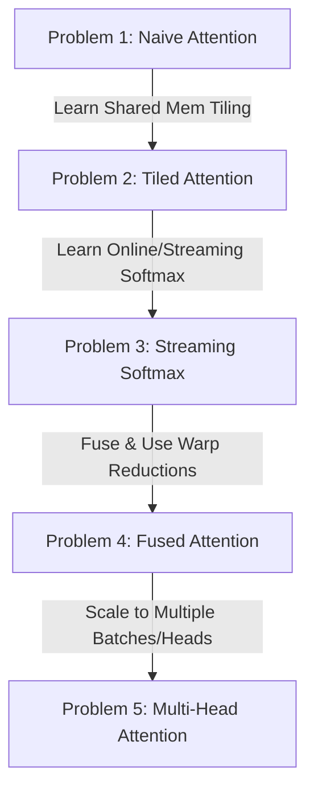

# ⚡ FlashAttention from Scratch: A GPU Practice Workspace

Welcome to your structured hands-on workspace for learning and implementing **FlashAttention** from scratch! This repository is formatted as a series of 5 progressive, LeetCode-style CUDA coding challenges.

Each folder contains:
1. **`main.cu`**: A standalone C++ CUDA harness. It generates random $Q, K, V$ matrices, runs a CPU-side reference implementation, verifies your GPU output with a tolerance check ($|GPU - CPU| < 10^{-4}$), and benchmarks performance. **You only need to implement the CUDA kernel!**
2. **`README.md`**: Detailed mathematical background, tiling block constraints, performance goals, and helpful implementation hints.
3. **`build.sh`**: A shell script to compile and execute the code in a Linux or WSL environment.

---

## 🗺️ Learning Roadmap



### 🧩 The 5 Core Challenges
1. **[Problem 1: Naive Dense Attention](file:///c:/Users/phamt/Desktop/projects/CUDA_things/problem1_naive/README.md)**: Establish a correctness baseline by implementing standard Softmax-based attention directly without optimizations.
2. **[Problem 2: Tiled Attention (Memory Optimization)](file:///c:/Users/phamt/Desktop/projects/CUDA_things/problem2_tiled/README.md)**: Optimize memory traffic by partitioning the inputs into small tiles loaded into `__shared__` memory.
3. **[Problem 3: Streaming Softmax (FlashAttention Core)](file:///c:/Users/phamt/Desktop/projects/CUDA_things/problem3_streaming/README.md)**: Implement the core mathematical breakthrough of FlashAttention—computing row-wise softmax step-by-step using a running max and normalizer, without writing out the large $N \times N$ attention matrix to global memory.
4. **[Problem 4: Fused Attention (End-to-End Kernel)](file:///c:/Users/phamt/Desktop/projects/CUDA_things/problem4_fused/README.md)**: Fuse tiling and streaming softmax into a single kernel. Use warp-level shuffle instructions (`__shfl_sync`) to achieve professional-grade performance.
5. **[Problem 5: Multi-Head Attention Extension](file:///c:/Users/phamt/Desktop/projects/CUDA_things/problem5_mha/README.md)**: Scale the fused attention kernel to handle batches and multiple heads, matching PyTorch's `nn.MultiheadAttention` layout of $(B, H, N, D)$.

---

## 🐧 Working with WSL (Windows Subsystem for Linux)

Since your CUDA environment and `nvcc` compiler are set up inside WSL, you can compile and run these exercises seamlessly because Windows directories are automatically mounted inside WSL under `/mnt/c/`.

### How to compile and run:

1. **Open your WSL Terminal**.
2. **Navigate to this workspace**:
   ```bash
   cd /mnt/c/Users/phamt/Desktop/projects/CUDA_things
   ```
3. **Go to a specific problem and run the build script**:
   ```bash
   cd problem1_naive
   chmod +x build.sh
   ./build.sh
   ```

Alternatively, you can trigger WSL compilation directly from Windows PowerShell:
```powershell
wsl bash -c "cd /mnt/c/Users/phamt/Desktop/projects/CUDA_things/problem1_naive && chmod +x build.sh && ./build.sh"
```

Let's get started on **Problem 1: Naive Dense Attention**!
